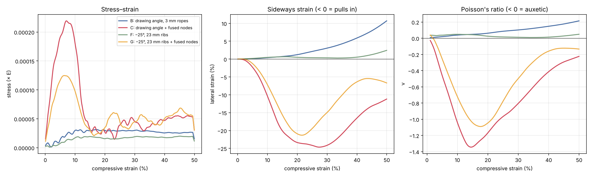

# Coarse-Grained Simulation of Compression and Auxetic Response in a 3D Woven Re-entrant Lattice


[](https://doi.org/10.5281/zenodo.24517090)
[](http://creativecommons.org/licenses/by-nc/4.0/)

A coarse-grained **simulation of a 3D woven re-entrant (auxetic) lattice under uniaxial compression to 50 % strain**, using LAMMPS.

**How the lattice is built**
- The parent lattice is the hourglass re-entrant honeycomb, with 17 mm ribs, 14.7 mm struts and a 28.7 mm cell height.
- It is converted into a **woven lattice** with a graph-based recipe: every beam becomes a rope of twisted helical fibres.
- At each node, the fibres turn smoothly from one beam into the next, so the whole 4 × 4 × 4 lattice is made of only 68 long continuous fibres.
- Each fibre is a chain of breakable beam bonds (BPM package, `bond_style bpm/rotational`) that resist stretching, shear, bending and twisting.
- Different fibres interact through frictional contact. Where they touch inside a node they are **fused**, which gives the joints the stiffness of a 3D-printed woven part.

**What the simulation captures**
- the **negative Poisson's ratio**: the sides pull inward under compression, down to ν ≈ −1.3;
- the **hourglass-shaped collapse** of the whole block;
- the **stress peak** followed by joint and fibre breakage;
- the **densification** of the folded cells at large strain.

It also shows that the auxetic response depends on the joints. With frictional (unfused) nodes, the same woven lattice bulges outward.


---

## Physics

The simulation captures the compression response of a woven re-entrant lattice at the fibre scale:

- **Fibres:** each fibre is a chain of spherical beads joined by `bpm/rotational` beam bonds. The stretching, shear, twist and bending stiffness follow from the fibre diameter and Young's modulus.
- **Geometry:** a Python script turns the re-entrant parent lattice into a woven lattice. There are no external CAD files.
- **Bundles:** every in-plane beam is a bundle of 4 helical fibres making half a turn along the beam. Every y-beam carries one fibre per in-plane beam at that node.
- **Node turns:** each angular sector between neighbouring beams at a node carries one fibre turn (the 2D analogue of the octahedron edges of a cubic woven node). Wide sectors (> 150°) are wrapped round the node.
- **Fused nodes:** fibre beads of different fibres that touch inside a node are joined by extra bonds of the same material (bond type 2). This makes the joints stiff instead of only frictional.
- **Contact:** different fibres touch through linear-spring (Hooke) contact with Coulomb friction (`pair_style granular`, μ = 0.3). There is no self-contact within a fibre.
- **Breakage:** bonds break when the combined load ratio reaches 1, so fibres and joints can fail progressively.
- **Loading:** displacement-controlled. The bottom rib row is held fixed and the top rib row moves down at a constant strain rate; both rows are bonded grips (clamped platens).
- **Boundaries:** the sides are free and all boundaries are shrink-wrapped, so the lattice can freely shrink or bulge sideways.
- **Measurements:** sideways strain is taken at mid-height between the left and right edge bands, giving the Poisson's ratio ν = −ε_x / ε_z.

---

## Loading Rate Regime

Units are LAMMPS `lj`. Lengths are in mm; the fibre Young's modulus E = 1 and density ρ = 1, so the unit of time τ is set by the fibre wave speed √(E/ρ) = 1 mm/τ.

| Process                                         | Time scale (τ)  | This Simulation                      |
| ----------------------------------------------- | --------------- | ------------------------------------ |
| Fastest bead vibration (contact), period        | ~2.7            | Resolved (dt = 0.0298, ~90 steps)    |
| Elastic wave along a fibre over the lattice height | ~120         | Yes                                  |
| Loading to 50 % strain at `erate 2e-4` (example run) | 2,500      | Yes                                  |
| Loading to 50 % strain at `erate 1e-4` (default) | 5,000          | Yes                                  |
| Quasi-static laboratory test                    | minutes         | No                                   |

The woven lattice is far more compliant than its fibres, so the loading is not fully quasi-static. Stresses carry some dynamic noise and depend somewhat on rate. Run at a 2× slower rate (`-var erate 5e-5`) and check that the curves agree before drawing quantitative conclusions.

---

## Woven Re-entrant Lattice



The parent lattice is the standard re-entrant honeycomb drawn with horizontal ribs.

- **Cells:** every cell is an hourglass. Its top and bottom are ribs, and its sides are zig-zag struts pointing inward.
- **Columns:** neighbouring hourglass columns are offset by half a cell. They are joined by the waist ribs and share their zig-zag walls.

| Parameter              | Script keyword | Default          | Role                                                          |
| ---------------------- | -------------- | ---------------- | ------------------------------------------------------------- |
| Hourglass columns      | `Nx`           | 4                | Cells along x                                                 |
| Hourglass rows         | `Nz`           | 4                | Cells along z (loading direction)                             |
| Cells through depth    | `Ny`           | 4                | Ny + 1 = 5 layers joined by y-beams                           |
| Rib length             | `h`            | 17.0 mm          | Cell width                                                    |
| Strut length           | `l`            | 14.7 mm          | Inclined walls                                                |
| Cell height            | `cell_h`       | 28.7 mm          | Sets the re-entrant angle θ = −arccos(cell_h / 2l) = −12.53°  |
| Layer spacing          | `Ly`           | 17.0 mm          | Length of the y-beams                                         |
| Bundle thickness       | `t_beam`       | 3.0 mm           | Outer diameter 2 R_eff + d of each fibre rope                 |
| Bundle twist           | `n_quarter`    | 2                | n_rev = n_quarter / 4 revolutions per beam (0 = straight)     |
| Fibre diameter ratio   | `d_ratio`      | 1.2              | d / R_eff, reduced automatically if fibres would overlap      |
| Fused nodes            | `fuse_nodes`   | True             | Bond fibres where they touch inside the nodes                 |
| Fusion distance        | `fuse_gap`     | 0.5              | Fuse bead pairs closer than (1 + fuse_gap) d                  |

The geometry builder prints the cell size and re-entrant angle, the bundle and fibre sizes, the closest distance between different fibres, the number of beads, bonds, fibres, free fibre ends and fused joints, and the lattice size.

---

## Geometry

```
Front view (x-z plane), one layer, 4 x 4 hourglass cells, units: mm

z = 118  ___      ___      ___      ___       <- top rib row (gripped, moves down)
         \ /      \ /      \ /      \ /
          X ______ X ______ X ______ X        <- waist ribs join neighbouring columns
         / \      / \      / \      / \
        |___|    |___|    |___|    |___|      <- hourglass: ribs 17 mm, struts 14.7 mm
         \ /      \ /      \ /      \ /
          X ______ X ______ X ______ X
          ...       (4 rows of hourglasses)
z =   0  ___      ___      ___      ___       <- bottom rib row (gripped, fixed)
        x = 0                         x = 103

        each waist corner points inward by l sin|theta| = 3.19 mm
        cell 17.0 x 28.7 mm, period along x = 2h - 2 l sin|theta| = 27.6 mm

x: rib direction (sideways strain measured here)
y: depth, 5 layers 17 mm apart, joined by y-beams
z: loading direction (compression)
Boundary: shrink-wrapped (s s s), no periodic images, bonded grips at z_min and z_max
```

- **Lattice**: 4 × 4 × 4 cells, 103.3 × 69.9 × 117.9 mm (x y z)
- **Parent beams**: 768, of which 512 are in-plane (ribs and struts) and 256 are y-beams
- **Fibre bundle**: 3.0 mm thick, R_eff = 0.94 mm, fibre diameter d = 1.125 mm, half a turn per beam
- **Bead spacing**: 0.9 mm (0.8 d)
- **Fibres**: 68 continuous fibres with 96 free ends at the outer faces

### Default System Size

| Component                          | Type          | Count      |
| ---------------------------------- | ------------- | ---------- |
| Fibre beads                        | atom type 1   | 43,648     |
| Fibre bonds (along each fibre)     | bond type 1   | 43,600     |
| Fused node joints (between fibres) | bond type 2   | 9,456      |
| Continuous fibres                  | molecule IDs  | 68         |
| Bottom grip / top grip             | groups        | 1,316 / 1,316 |
| **Total bonds**                    | -             | **53,056** |

---

## Simulation Phases

| Phase            | Run Steps       | Simulated Strain | Description                                                        |
| ---------------- | --------------- | ---------------- | ------------------------------------------------------------------ |
| Geometry         | -               | -                | Python builds the woven lattice and writes `woven_lattice.data`    |
| Compression      | 168,010         | 0 → 50 %         | Top grip moves down at `erate 1e-4`, bottom grip fixed             |
| **Total**        | **168,010**     | **50 %**         | -                                                                  |

There is no separate relaxation stage: the lattice is built stress-free and loaded straight away. The example run used `-var erate 2e-4` (84,005 steps). It took 18 minutes on 1 core.

---

## Key Event Timeline

There is one dump frame per 1 % strain. The values below are from the example run (`erate 2e-4`, 1,680 steps per frame); use `stress_strain.txt` for your own run.

| Event                                                      | Strain    | MD step          | Dump frame |
| ---------------------------------------------------------- | --------- | ---------------- | ---------- |
| Top grip starts moving, sides start pulling inward         | ~0.6 %    | ~1,000           | 0 to 1     |
| Stress peak, 2.2 × 10⁻⁴ E                                  | ~7.1 %    | ~11,900          | 7          |
| First bonds break (joints and fibres near the waists)      | ~9.2 %    | ~15,500          | 9          |
| Strongest auxetic response, ν ≈ −1.34                      | ~14.5 %   | ~24,400          | 14 to 15   |
| Stress minimum after the peak, 1.5 × 10⁻⁵ E                | ~23 %     | ~38,800          | 23         |
| Largest sideways contraction, −24.7 %                      | ~27 %     | ~45,900          | 27         |
| Cells close up, ν back to −0.8; stress rises again         | 30 %      | ~50,500          | 30         |
| End of run, ν = −0.22, sideways strain −11 %, 97.7 % bonds intact | 50 % | 84,005    | 50         |

---

## Material Parameters

### Fibres

| Parameter                  | Symbol  | Value            | Unit (lj)     |
| -------------------------- | ------- | ---------------- | ------------- |
| Young's modulus            | E       | 1.0              | stress        |
| Poisson's ratio (fibre)    | ν_f     | 0.30             | -             |
| Density                    | ρ       | 1.0              | mass/volume   |
| Fibre diameter             | d       | 1.125            | mm            |
| Bead spacing               | ds      | 0.90             | mm            |
| Failure stress / E         | σ_f     | 0.25             | -             |
| Damping (fraction of critical) | ζ   | 0.3              | -             |

Stresses scale with E: multiply the output stress by your fibre modulus (for example in MPa) to get physical values.

### Beam Bonds (`bond_style bpm/rotational normalize yes`)

| Coefficient           | Formula            | Value     |
| --------------------- | ------------------ | --------- |
| Radial stiffness      | K_r = E A          | 0.994     |
| Shear stiffness       | K_s = 0.9 G A      | 0.344     |
| Twist stiffness       | K_t = G J / ds     | 0.0672    |
| Bend stiffness        | K_b = E I / ds     | 0.0874    |
| Critical radial force | F_r,c = σ_f A      | 0.249     |
| Critical shear force  | F_s,c = 0.6 σ_f A  | 0.149     |
| Critical twist torque | τ_t,c = 0.6 σ_f J / a | 0.0419 |
| Critical bend torque  | τ_b,c = σ_f I / a  | 0.0349    |

Fused joints (bond type 2) use the same coefficients as the fibres. All values are written by the builder into `woven_lattice.bonds`.

### Contact and Dynamics

| Parameter                  | Symbol   | Value                  |
| -------------------------- | -------- | ---------------------- |
| Contact model              | -        | `granular` Hooke normal + `linear_history` tangential |
| Normal contact stiffness   | k_n      | 2.475 (= 2.2 E d)      |
| Tangential stiffness       | k_t      | 0.5 k_n                |
| Friction coefficient       | μ        | 0.3                    |
| Timestep                   | dt       | 0.02976 (= 0.07 / ω_max) |
| Integrator                 | -        | `fix nve/bpm/sphere` (positions and rotations) |
| Strain rate                | erate    | 1 × 10⁻⁴ (default), 2 × 10⁻⁴ (example run) |
| Communication cutoff       | -        | 4.0 mm                 |

### Boundary Conditions

| Group        | Condition                         | Description                                          |
| ------------ | --------------------------------- | ---------------------------------------------------- |
| `gripB`      | `fix move linear 0 0 0`           | Bottom rib row (beads within 1.5 mm of z_min), fixed |
| `gripT`      | `fix move linear 0 0 -v`          | Top rib row, moves down at v = erate × L_g           |
| `mobile`     | `fix nve/bpm/sphere`              | All other beads, free                                |
| All directions | Shrink-wrapped (s)              | No periodic images, sides free to move in or out     |

---

## Governing Equations

### Re-entrant Geometry

```
theta  = -arccos( cell_h / (2 l) )                  re-entrant angle (negative)
l_c    = l cos|theta|                               strut extent across the ribs (half cell height)
l_s    = l sin|theta|                               inward offset of each waist corner
H      = 2 h - 2 l_s                                period along the ribs

rib (i, k)  :  z = i l_c,   x from k H + (i mod 2) H/2   to   + h
strut       :  right end of rib (i, k)  ->  left end of rib (i +- 1, k + i mod 2)
```

Rigid-joint reference (Gibson–Ashby), for loading perpendicular to the ribs:

```
nu = cos^2(theta) / ( (h/l + sin(theta)) sin(theta) )     ~ -4.7 for this cell
```

The woven lattice cannot reach this value: its joints are fibre turns, not rigid nodes.

### Woven Bundles

```
fibre k on beam AB (axis e, frame e1, e2):
  P(s)   = A + s e + R_eff [ cos(phi_k(s)) e1 + sin(phi_k(s)) e2 ],   s in [delta_A, L - delta_B]
  phi_k  = phi_k,A + Delta_k (s - delta_A) / L_h,                      Delta_k ~ 2 pi n_rev

node region size  delta = R_eff / tan(alpha_min / 2) + d       (alpha_min = smallest angle between beams)
node turn         = cubic Hermite curve from the slot on beam i to the slot on beam j,
                    through a wrap point at 0.7 x node size for sectors wider than 150 deg
```

### Bond Breaking (`bpm/rotational`)

```
B = max{ 0,  F_r / F_r,c  +  |F_s| / F_s,c  +  |tau_t| / tau_t,c  +  |tau_b| / tau_b,c }

the bond breaks when B >= 1  (fibre and fused-joint bonds alike)
```

### Strain, Stress and Poisson's Ratio

```
L_g          = z_top grip - z_bottom grip            gauge length (114.9 mm)
A_0          = W x D                                  nominal area (7,221 mm^2)

eps_z(t)     = ( d_0 - d(t) ) / L_g                   compressive strain (> 0), d = distance between grip centres
F(t)         = 0.5 ( F_z,top - F_z,bottom )           compressive force (> 0)
sigma(t)     = F(t) / A_0                             compressive stress (> 0)

eps_x(t)     = ( w(t) - w_0 ) / w_0                   sideways strain, w = distance between left and right edge bands at mid-height
nu(t)        = -eps_x / eps_z                         Poisson's ratio (< 0 = auxetic)
```

---

## Group Definitions

```
gripB    <- beads with z < z_min + 1.5 mm   (bottom rib row, fixed)
gripT    <- beads with z > z_max - 1.5 mm   (top rib row, moves down)
grips    <- gripB + gripT
mobile   <- all - grips                      (integrated with nve/bpm/sphere)
edgeL    <- beads with x < x_min + 5 mm, middle 40 % of the gauge length
edgeR    <- beads with x > x_max - 5 mm, middle 40 % of the gauge length
```

The molecule ID of each bead is its fibre number (1 to 68). Contact is switched off within the same fibre.

---

## Output Files

| File                      | Frequency          | Content                                                                    |
| ------------------------- | ------------------ | -------------------------------------------------------------------------- |
| `woven_lattice.data`      | once               | Woven lattice (atom_style bpm/sphere) with both bond types                 |
| `woven_lattice.bonds`     | once               | Bond coefficients, fibre diameter, contact stiffness and timestep          |
| `woven_lattice_ovito.data`| once               | Same lattice in atom_style bond, for OVITO                                 |
| `stress_strain.txt`       | every 0.1 % strain | step, strain, stress, force, sideways strain, ν, intact bonds              |
| `lattice.dump`            | every 1 % strain   | id, mol, type, x, y, z, bond count, szz (51 frames)                        |
| `lattice_bonds.dump`      | every 1 % strain   | Current bond list, so broken bonds disappear in OVITO                      |
| `log.lammps`              | every 1 % strain   | Full log with thermo output                                                |
| `compression_results.png` | after run          | Stress–strain, sideways strain, Poisson's ratio, intact bonds              |
| `lattice_view.ovito`      | after run          | OVITO session: fibres as blue tubes                                        |
| `lattice_fibres.ovito`    | after run          | OVITO session: one colour per fibre (shows the weave)                      |
| `lattice_stress.ovito`    | after run          | OVITO session: axial stress σ_zz per bead                                  |

### Per-Bead Quantities in `lattice.dump`

| Column  | Quantity                                        |
| ------- | ----------------------------------------------- |
| `id`    | Bead ID                                         |
| `mol`   | Fibre number                                    |
| `type`  | 1 (all beads)                                   |
| `x y z` | Position (mm)                                   |
| `c_nb`  | Number of intact bonds of the bead              |
| `szz`   | Stress × volume, zz component (pair + bond)     |

### Thermo Columns in `log.lammps`

| Column      | Quantity                                       |
| ----------- | ---------------------------------------------- |
| `v_strainc` | Compressive strain                             |
| `v_stress`  | Compressive stress (× E)                       |
| `v_latstr`  | Sideways strain at mid-height                  |
| `v_poisson` | Poisson's ratio ν = −ε_x / ε_z                 |
| `v_bonds`   | Number of intact bonds                         |
| `c_ke`      | Kinetic energy of the mobile beads             |

---

## Repository Structure

```
woven_reentrant_4x4x4/
|
|-- build_reentrant_woven.py    # Builds the woven re-entrant lattice (woven_lattice.data, .bonds, _ovito.data)
|-- in.compression_lattice      # Main LAMMPS script (grips, compression to 50 %, outputs)
|-- run_compression.sh          # One-command pipeline for Ubuntu / WSL (build, mpirun, plots, OVITO sessions)
|-- plot_compression.py         # Stress-strain, sideways strain, Poisson's ratio, damage
|-- make_lattice_session.py     # Ready-made OVITO sessions (view, fibres, stress)
|-- README.md                   # This file
|
|-- variants_compression.png    # Example runs: front views at 0, 15, 30, 50 % strain (4 versions)
|-- variants_curves.png         # Example runs: stress, sideways strain, Poisson's ratio (4 versions)
```

---

## How to Run

### Requirements

- LAMMPS with the **BPM**, **GRANULAR** and **MOLECULE** packages, built with MPI: <https://www.lammps.org>
- Python 3 with numpy, scipy and matplotlib (ovito optional, for the session files)
- OpenMPI or MPICH for parallel runs
- OVITO for trajectory visualization: <https://www.ovito.org>

On Ubuntu or WSL, build LAMMPS once:

```
sudo apt update
sudo apt install -y build-essential cmake git openmpi-bin libopenmpi-dev python3-venv dos2unix
git clone -b stable --depth 1 https://github.com/lammps/lammps.git ~/lammps
cd ~/lammps && mkdir build && cd build
cmake ../cmake -D BUILD_MPI=on -D PKG_BPM=on -D PKG_GRANULAR=on -D PKG_MOLECULE=on -D PKG_EXTRA-FIX=on
make -j 14 && sudo cp lmp /usr/local/bin/lmp
```

### Step 1: Choose the lattice

Edit the inputs at the top of `build_reentrant_woven.py`, then:

```
python3 build_reentrant_woven.py
```

Useful variations:

```
fuse_nodes = False                     # frictional nodes only (not auxetic)
cell_h = 26.645 ;  h = 23.0            # deeper re-entrant angle (-25 deg) with a wider waist
t_beam = 5.0                           # thicker ropes, weave even more visible
t_beam = 1.0                           # thin 1 mm beams of the original drawing (138k beads)
n_quarter = 0                          # straight fibres in each beam
```

### Step 2: Run the simulation

Full pipeline in one line (geometry, MD, plots, OVITO sessions):

```
nohup ./run_compression.sh > run.out 2>&1 &
```

Or step by step:

```
python3 build_reentrant_woven.py
mpirun -np 14 lmp -in in.compression_lattice -log log.lammps
python3 plot_compression.py
python3 make_lattice_session.py
```

Change simulation settings without editing the script:

```
mpirun -np 14 lmp -in in.compression_lattice -var erate 5e-5 -var strain 0.6 -var mu 0.5
NP=8 EXTRA="-var erate 2e-4" ./run_compression.sh
```

The default lattice has about 44,000 beads, so the full run takes about 30 minutes on 1 core and a few minutes on 14 cores.

If the files were edited or extracted on Windows, convert line endings first: `dos2unix *.py *.sh in.compression_lattice`.

### Step 3: Visualize in OVITO

1. Open OVITO, then `File > Load Session State` and select `lattice_fibres.ovito` (one colour per fibre)
2. Press **Play**: the 51 frames show the lattice from 0 to 50 % strain
3. `lattice_view.ovito` shows all fibres as blue tubes; `lattice_stress.ovito` colours them by σ_zz
4. Or load `woven_lattice_ovito.data` manually, add **Load trajectory** with `lattice.dump`, and a second **Load trajectory** with `lattice_bonds.dump` so broken bonds disappear
5. Set the particle radius and bond width to the fibre diameter (in `woven_lattice.bonds`) to render the fibres as smooth tubes
6. Use the front view (looking along y) to see the hourglass cells fold inward

Each dump frame is 1 % strain (frame 15 = 15 %, frame 50 = 50 %).

---

## What to Look for in Results

### Negative Poisson's Ratio

The sides pull inward from the first percent of strain. In the example run ν is −1.04 at 10 %, reaches about −1.34 at 14.5 %, and stays negative up to 50 % (−0.22). The panel "Poisson's ratio" in `compression_results.png` should sit below zero.

### Hourglass Collapse of the Block

The mid-height of the lattice contracts while the gripped rows keep their width, so the whole block takes an hourglass shape. The largest sideways contraction is about −25 % at 27 % strain.

### Stress Peak and Damage

The fused lattice is stiff at first. The stress peaks near 7 % strain, then some fused joints and fibres near the waists break and the stress drops to a plateau. About 2.3 % of the bonds break by 50 % strain.

### Densification

After about 25 % strain the cells close up and the fibres pack together. ν moves back toward zero and the stress rises again.

### Effect of the Joints

The woven nodes decide the response. In the four example runs (`variants_curves.png`):

| Version                                   | ν at 10 % | ν at 20 % | ν at 50 % | Peak stress (× E) |
| ----------------------------------------- | --------- | --------- | --------- | ----------------- |
| Drawing angle −12.5°, 3 mm ropes          | +0.04     | +0.06     | +0.21     | 3.1e-5            |
| **Drawing angle + fused nodes (default)** | **−1.04** | **−1.17** | **−0.22** | **2.2e-4**        |
| −25°, ribs 23 mm                          | +0.05     | +0.02     | +0.05     | 2.0e-5            |
| −25°, ribs 23 mm + fused nodes            | −0.72     | −1.05     | −0.13     | 1.2e-4            |

With frictional nodes the struts bow outward and the lattice is not auxetic, even with a deeper re-entrant angle. Fusing the nodes makes it auxetic and about 7× stiffer.

### Loose Debris

Beyond about 25 % strain, short fibre pieces break free next to the clamped rows and fly off. They are visible in the 30 % and 50 % frames.

---

## Common Errors and Fixes

| Error or symptom                                    | Cause                                                       | Fix                                                                        |
| --------------------------------------------------- | ----------------------------------------------------------- | -------------------------------------------------------------------------- |
| `ERROR: LAMMPS package BPM is not installed`        | LAMMPS built without BPM, GRANULAR or MOLECULE              | Rebuild with `-D PKG_BPM=on -D PKG_GRANULAR=on -D PKG_MOLECULE=on`         |
| `LAMMPS executable not found`                       | Executable has another name                                 | `LMP=lmp_mpi ./run_compression.sh`, or give the full path                  |
| `WARNING: Communication cutoff ... shorter than a bond length based estimate` | Fused joint bonds longer than the ghost cutoff | Keep `comm_modify vel yes cutoff 4.0` in `in.compression_lattice`         |
| `ERROR: Bond atoms missing`                         | Same cause, with a bond crossing a processor boundary       | Same fix; restart the run                                                  |
| `beads 26688` or `beads 138048` in `run.out`        | An older `build_reentrant_woven.py` in the folder           | Copy the new files out of the unzipped subfolder (`cp woven_reentrant_4x4x4/* .`) |
| No `fused node joints` line in `run.out`            | `fuse_nodes = False` or old builder                         | Set `fuse_nodes = True`                                                    |
| Lattice bulges outward instead of shrinking         | Frictional nodes or thick ropes                             | Use `fuse_nodes = True`; check ν in `compression_results.png`              |
| Fibres snap at about 2 % strain                     | Brittle fibres (`sigma_f = 0.05`)                           | Use `sigma_f = 0.25` (default)                                             |
| `ave/time` error about nfreq                        | Output interval too short                                   | Leave `ostrn` at 0.001 or larger                                           |
| `Lost atoms` or exploding beads                     | Timestep too large after editing the geometry               | Use `-var dt0 0.01`, or rebuild so `dtauto` is recomputed                  |
| `tail: cannot open 'log.lammps'`                    | LAMMPS has not started yet                                  | Use `tail -F run.out`                                                      |
| `$'\r': command not found`                          | Windows line endings                                        | `dos2unix *.py *.sh in.compression_lattice`                                |
| `externally-managed-environment` from pip           | Ubuntu blocks system-wide pip                               | `run_compression.sh` creates a `.venv` automatically                       |
| `not enough slots` from mpirun                      | Fewer cores than `-np`                                      | `NP=$(nproc) ./run_compression.sh`                                         |
| Very slow run under WSL                             | Files on a Windows drive (`/mnt/d/...`)                     | Copy the folder to the Linux home directory first                          |
| Noisy stress, negative values early on              | Dynamic loading of a compliant lattice                      | Lower the rate (`-var erate 5e-5`) or add damping (`-var visc 1e-4`)       |

---

## Extending the Model

| Extension                              | What to change                                                                  |
| -------------------------------------- | ------------------------------------------------------------------------------- |
| Rate convergence                       | Repeat with `-var erate 5e-5`, `2e-5`                                           |
| Stronger or weaker joints              | Change `fuse_gap`, or give bond type 2 its own strength in `woven_lattice.bonds` |
| Different re-entrant angle             | Change `cell_h` (and `h` to keep the waist open)                                |
| Weave pattern                          | Change `t_beam`, `n_quarter`, `d_ratio`                                         |
| Larger specimens                       | Increase `Nx`, `Ny`, `Nz` (fewer edge effects)                                  |
| Friction effects                       | `-var mu 0`, `0.5`, `1.0`                                                       |
| Tension instead of compression         | Change the sign of the grip velocity in `in.compression_lattice`                |
| Cyclic loading and energy absorption   | Reverse the grip velocity after a chosen strain and integrate the hysteresis    |
| Other parent lattices                  | Replace the rib/strut graph in the builder (simple cubic, BCC, chiral, star)    |
| Comparison with a solid lattice        | Same cell with `t_beam = 1` and `fuse_nodes = True`, or a beam-element FE model |

---

## Citation

If you use this code in your research, please cite:

```
@software{mishra_2026_woven_reentrant,
  author    = {Mishra, Akshansh},
  title     = {Coarse-Grained Simulation of Compression and Auxetic
               Response in a 3D Woven Re-entrant Lattice},
  year      = {2026},
  publisher = {Zenodo},
  doi       = {10.5281/zenodo.24517090},
  url       = {https://doi.org/10.5281/zenodo.24517090}
}
```

Plain text citation:

> Mishra, A. (2026). *Coarse-Grained Simulation of Compression and Auxetic Response in a 3D Woven Re-entrant Lattice* [Computer software]. Zenodo. <https://doi.org/10.5281/zenodo.24517090>

Please also cite the BPM package:

> J. T. Clemmer, J. M. Monti, J. B. Lechman, "A soft departure from jamming: the compaction of deformable granular matter under high pressures", *Soft Matter* 20, 1702-1718 (2024). doi:10.1039/D3SM01373A

---

## Author

**Akshansh Mishra**
GitHub: <https://github.com/akshansh11>

---

## License

<a rel="license" href="http://creativecommons.org/licenses/by-nc/4.0/"></a><br />
This work is licensed under a <a rel="license" href="http://creativecommons.org/licenses/by-nc/4.0/">Creative Commons Attribution-NonCommercial 4.0 International License</a>.

You are free to:

- **Share**: copy and redistribute the material in any medium or format
- **Adapt**: remix, transform, and build upon the material

Under the following terms:

- **Attribution**: You must give appropriate credit to Akshansh Mishra and provide a link to this repository
- **NonCommercial**: You may not use the material for commercial purposes

Copyright 2026 Akshansh Mishra. All rights reserved for commercial use.
